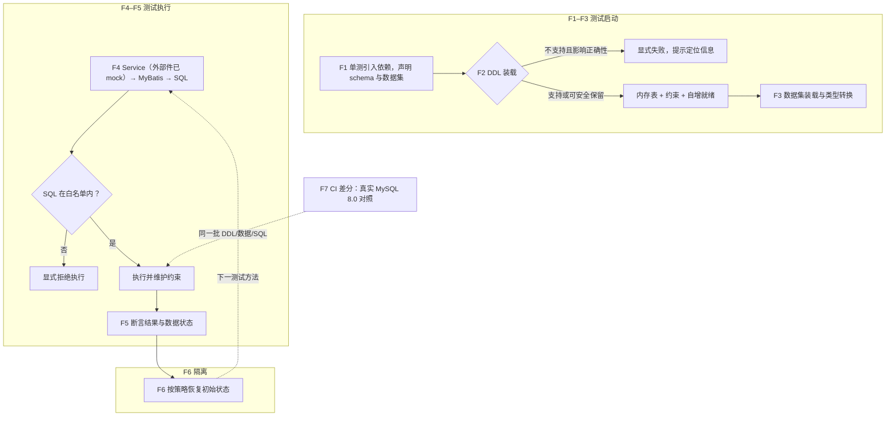

# mysql-mock-engine：业务流与决策

## 1. 背景与目标

dine 组 Java 服务的统一基线是 JDK 8 / Spring Boot 2.1.3 / MyBatis-Plus 3.4.3.4（证据见实施方案 §2）。业务单测现状（已核实，见实施方案 §2）：单测骨架是 JUnit 5 + Mockito 的纯单测，不起 Spring 上下文（两服务 0 个 @SpringBootTest）；DB 层要么 Mock Mapper 丢掉 SQL 与映射的真实性，要么退化为断言 SQL 文本，真正执行 SQL 要起 Docker MySQL。点销已在 test 域用 jedis-mock 做中间件内存替身，MySQL 是同模式下缺失的一环。目标是做一个纯 JVM 内存、面向测试的 MySQL 模拟引擎 mysql-mock-engine：消费方添加一个 test 依赖、复用现有 schema.sql 与数据集文件、不改 Mapper，即可运行完整 Service → Mapper → SQL 链路并断言数据状态变化。硬约束：必须支持 JDK 8+（用户指定；引擎进程内嵌入、第一版无网络协议，没有绕开路径，评审记录 P1-1）。

方案概要：自建 Schema、存储与测试数据生命周期模型；查询复用 Apache Calcite（官方声明以 JDK 8 测试的最新版本线，D-11）做解析与执行，INSERT/UPDATE/DELETE 由自有执行器完成（D-03）；DDL 解析复用 ShardingSphere SQL Parser（钉 5.3.2）转为自有表模型；发布物 shade 隔离全部传递依赖，消费方 classpath 零新增（D-12）；底层以标准 DataSource 为接入基础，一等接入形态是 JUnit 5 扩展加无 Spring 的 MyBatis 装配助手，直接嵌入现有 JUnit + Mockito 单测（外部协作件继续 mock，SQL 真执行）；Spring Boot starter（Boot 2.1 起双轨注册）为后续接入阶段；测试隔离 RECREATE 起步、SNAPSHOT 跟进；以真实 MySQL 8.0 做差分兼容验证（仅 CI 兼容阶段使用真库，基准参数随语料采集，D-09）。

本期不做：MySQL 网络协议、通用 SQL 引擎（白名单制）、生产用途、dine 现存仓的迁移接入（另期）；Boot 3.x 与高版本 JDK 不承诺（OQ-4 已答复：先不承诺），兼容验收收敛为 JDK 8 + Boot 2.1。

## 2. 业务流与验收标准

参与者：业务开发者（写并运行测试）、CI（执行测试与差分兼容）。

- F1 开发者在 JUnit + Mockito 单测里引入 mysql-mock（扩展或原生 API），声明 schema 与数据集。
- F2 引擎装载真实 MySQL DDL 建内存表；影响正确性又不支持的特性显式失败，不影响正确性的元数据接受保留。
- F3 装载 YAML 数据集，按列类型转换入库。
- F4 测试调用被测 Service（外部协作件由 Mockito mock），MyBatis 的 SQL 进入内存引擎执行，主键/唯一/非空/默认值/自增约束生效。
- F5 测试断言查询结果与数据状态（主键回填、影响行数）。
- F6 每个测试方法开始前恢复初始状态、结束后复位会话状态（JUnit 扩展触发；Spring 接入时不受上下文缓存影响）。
- F7 CI 兼容阶段：同一批 DDL/数据/SQL 分别在真实 MySQL 8.0 与引擎上执行，差分比较。

需求点：

- R1：真实 DDL 直接装载——UNSIGNED、DECIMAL(p,s)、DATETIME(p)、AUTO_INCREMENT、主键、唯一键、普通索引、STORED 生成列（表达式求值并参与唯一约束，现网语料在用）、清单内 collation 参与比较语义（D-16）、ENGINE/COMMENT；外键显式拒绝（现网 272 个 SQL 文件 0 命中）。
- R2：YAML 数据集装载，按列类型转换（金额 → BigDecimal，时间保留精度）。
- R3：白名单 SELECT——JOIN、GROUP BY、HAVING、ORDER BY、LIMIT、`?` 参数、NULL 语义与首批函数（IFNULL/COALESCE/NULLIF/IF/CASE、CONCAT/LENGTH/SUBSTRING/TRIM/LOWER/UPPER、ABS/ROUND/CEIL/FLOOR、NOW/CURDATE/DATE_FORMAT/DATE_ADD、聚合、IN/BETWEEN/LIKE/IS NULL/`<=>`）；已声明范围内结果与真实 MySQL 一致。
- R4：INSERT/UPDATE/DELETE——主键与唯一冲突、NOT NULL 与默认值、AUTO_INCREMENT、影响行数、Generated Keys、索引一致性。
- R5：JDBC 面——MyBatis 3.5.x 与 MyBatis-Plus 3.4.3.4 的 Mapper 不改 SQL 跑通：XML 动态 SQL、resultMap、useGeneratedKeys 回填、分页插件、逻辑删除、自动填充、批量写。
- R6：单测接入（一等）——JUnit 5 扩展与原生 API 在 JUnit + Mockito 单测内直接可用：装载 schema/数据集、提供无 Spring 的 MyBatis 装配助手（Mapper 直连内存引擎）、与 Mockito mock 的外部协作件同测共存；默认拒绝连接真实数据库。Spring Boot starter 自动装配（Boot 2.1 起可用，创建或显式接管 DataSource）为后续接入阶段。
- R7：测试隔离——RECREATE 先行、SNAPSHOT 跟进；自增、索引与会话状态随恢复重置；不受 Spring TestContext 缓存影响。
- R8：JDK 8+——字节码 52.0、无 JDK 9+ API；与 Boot 2.1 消费方 classpath 零冲突（D-12 shade 隔离，消费方依赖树零新增）。
- R9：未支持特性显式失败（strict 默认开），错误信息含 SQL 与定位。

## 3. 决策

### D-01 JDK 8 单轨字节码，不双轨发布
- **状态**：accepted（2026-10-11，批量批准）
- **决定**：全模块 source/target 1.8，产物只出 JDK 8 字节码一套；高版本 JVM 直接运行。
- **放弃的做法与代价**：Java 17 语法（record、文本块）与「JDK 8 + JDK 17 双工件」。失去新语法便利；双轨带来双倍测试矩阵与发布复杂度，收益只有语法层面。
- **后果**：CI 以 JDK 8 构建为准并启用 JDK 8 API 签名检查；新增代码不得使用 JDK 9+ API；本条是评审 P1-1 的直接回应。

### D-02 查询引擎钉 Calcite 1.36.0
- **状态**：superseded by D-11（2026-10-11，第 2 轮评审 P1-1：版本前提有误，官方 history.md 载明 1.37.0 起仍以 JDK 8 测试）
- **决定**：Calcite 固定 1.36.0——官方发布记录确认的最后一个 JDK 8 版本线，1.37.0 起要求 Java 11+。
- **放弃的做法与代价**：跟踪 Calcite 新版本。代价是修复与新特性冻结在 2023-11 的 1.36 线；换来 JDK 8 可运行与成熟的关系运算能力，避免自研执行器。
- **后果**：阶段 0 假设验证与后续 SQL 兼容都以 1.36.0 为准，新版本行为不可外推；升级即换引擎决策（新写 D supersede）；传递依赖窗口随之固定（guava 32.1.3-jre、avatica 1.23.0、slf4j 1.7.33）。

### D-03 DDL 走 ShardingSphere Parser，SELECT 查询走 Calcite，写操作全部自有
- **状态**：accepted（2026-10-11，批量批准）
- **决定**：`shardingsphere-sql-parser-mysql` 钉 5.3.2（该独立坐标的最后版本线），只用于 DDL 解析为自有表模型；SELECT 查询执行与表达式求值由 Calcite 承担；INSERT/UPDATE/DELETE 全部由自有执行器完成（Calcite 的表修改通道只实现 INSERT/DELETE、UPDATE 直接抛错、DELETE 绕过约束检查，不采用）；少量 MySQL 方言在适配层预处理。
- **放弃的做法与代价**：全量 AST 转换（等于自写一个 SQL 编译器）；DML 走 Calcite 可写表接口（实验性且 UPDATE 未实现，T0 全链会在 UPDATE 处失败）；或全部走 ShardingSphere（DML 执行能力弱）。放弃「单一引擎执行」的完整性，换来写路径约束可控。
- **后果**：两个解析器并存是长期结构事实；写操作的 WHERE 匹配复用 Calcite 表达式求值；方言差异集中登记在适配层；SS 5.3.2 的依赖面（ANTLR 4.10.1 runtime 等）由 D-12 shade 隔离。

### D-04 Spring Boot 注册双轨，编译基线钉 2.1
- **状态**：accepted（2026-10-11，批量批准）
- **决定**：同时发布旧机制注册文件（Boot 2.1–2.6 识别）与新机制注册文件（2.7+/3.x 识别）；自动配置代码按 Boot 2.1 可编译的方式编写，不依赖 2.7+ 才有的装配注解。Boot 2.1 + JDK 8 是兼容矩阵唯一承诺列与验收前提。
- **放弃的做法与代价**：只发新注册文件——Boot 2.1 上自动配置静默不加载，测试可能连真实库，正是评审 P2-2 的失败模式；或按 Boot 版本分叉多套装配代码，矩阵翻倍。
- **后果**：兼容矩阵只验 Boot 2.1 的旧机制注册路径，新机制注册文件随包发布但不做运行验证；Boot 3.x / JDK 17 先不承诺（OQ-4 已答复），将来要支持时再补矩阵与验证。Boot 2.1 对应的 Spring 5.1 没有动态属性测试机制，动态注入改走上下文初始化器或直接暴露 DataSource Bean。

### D-05 一等接入面是 JUnit 5 单测扩展与无 Spring 装配助手
- **状态**：accepted（2026-10-11，批量批准）
- **决定**：一等接入 = JUnit 5 扩展 + 无 Spring 的 MyBatis 装配助手，直接嵌入现有单测；底层接入基础仍是标准 DataSource；Spring Boot starter、自定义 JDBC URL 驱动后置；不实现 MySQL 网络协议。
- **放弃的做法与代价**：以 Spring Boot starter 自动装配为一等接入。单测不起 Spring 上下文，starter 路径对主场景绕远；换为直插单测骨架的代价是要自建无 Spring 的 MyBatis 装配助手。
- **后果**：装配助手须覆盖 Mapper 注册与 MyBatis-Plus 拦截器；starter 降为后续阶段，双轨注册决策（D-04）保留但后置实施；连接元数据自报 MySQL 协议形态（URL 前缀与产品名），MyBatis-Plus 分页插件据此自动识别方言，无需消费方显式配置（第 2 轮评审 P3-3，具体返回值见实施方案 §3.6）。

### D-06 隔离 RECREATE 先行、SNAPSHOT 次之，不用 @Transactional 回滚兜底
- **状态**：accepted（2026-10-11，批量批准）
- **决定**：第一版 RECREATE（每测试方法重放 DDL 与数据集），第二步 SNAPSHOT（初始化后快照、每方法恢复并重置自增/索引/会话）；不提供 TRANSACTION 隔离模式。
- **放弃的做法与代价**：依赖 Spring 测试事务回滚做隔离。REQUIRES_NEW、异步与显式提交的写入不被覆盖，隔离不可靠；换确定性的整库状态复位。
- **后果**：隔离动作与 Spring TestContext 缓存解耦，挂在测试执行监听器上，不与缓存的上下文同生命周期。

### D-07 Schema 与存储为自有模型，Calcite 只是可替换适配层
- **状态**：accepted（2026-10-11，批量批准）
- **决定**：表定义、行存储、索引、快照、约束全部自有；Calcite 只承担查询解析与表达式计算，通过适配接口接入；业务核心模型不持有 Calcite 类型。
- **放弃的做法与代价**：直接以 Calcite 的 Schema 体系为核心模型。换来替换执行器或升级引擎时不牵动存储与生命周期，代价是维护一层类型与接口映射。
- **后果**：MySQL 类型与 Calcite 类型的转换只允许发生在这一个映射点。

### D-08 金额走 BigDecimal，时间保精度与时区语义
- **状态**：accepted（2026-10-11，批量批准）
- **决定**：DECIMAL 全链 BigDecimal，不落 double；DATETIME(p)/TIMESTAMP(p) 保留秒以下精度，按会话时区解释。
- **放弃的做法与代价**：double 近似会让金额行为与真库不一致；代价是性能与实现复杂度上升。
- **后果**：JDBC 侧金额与时间的读取语义必须与差分测试对齐。

### D-09 真实 MySQL 只在 CI 差分阶段出现，基准参数随语料采集
- **状态**：accepted（2026-10-11，批量批准）
- **决定**：普通使用者零外部依赖；真实 MySQL 8.0 仅在差分 profile（CI 专用）作为行为基准，比较行、NULL、类型、排序、影响行数与错误。基准实例参数（sql_mode、collation、time_zone）随语料一并采集记录，引擎按采集值初始化会话。
- **放弃的做法与代价**：不做基准的自证兼容；或不采集参数、按引擎默认值跑差分（sql_mode/collation/时区不一致会制造假差异或掩盖真差异）。代价是 CI 需要可用的 MySQL 容器、语料格式多一层参数。
- **后果**：无 ORDER BY 的查询不做顺序比较；支持范围以差分报告为准，声明之外不承诺一致；语料未附基准参数的用例不得进入差分集；差分对非确定函数（NOW、CURDATE 等）在两侧注入同一固定时钟，无法注入的从结果比较中排除并标注。

### D-10 影响行数默认 matched 语义
- **状态**：accepted（2026-10-11，批量批准）
- **决定**：UPDATE 影响行数默认返回匹配行数（对齐 Connector/J 默认行为），提供配置切换 changed 语义；阶段 2 差分测试确认。
- **放弃的做法与代价**：固定一种语义。换取与消费方默认连接行为一致，且可显式切换。
- **后果**：UPDATE 中「值未变化」的行是否计入影响行数影响 MyBatis 更新返回值断言，测试文档须写明当前语义。

### D-11 Calcite 采用官方声明 JDK 8 兼容的最新版本线（supersede D-02）
- **状态**：accepted（2026-10-11，批量批准）
- **决定**：采用官方声明以 JDK 8 测试的最新 Calcite 版本（当前 1.42.0，2026-05），不钉 1.36.0；T0 第一项先断言该版本 jar 字节码为 52 并在 JDK 8 运行通过。
- **放弃的做法与代价**：钉 1.36.0。其「最后一个 JDK 8 版本」的前提是错的（第 2 轮评审核实官方 history.md），钉死等于无故放弃约两年半的修复与 MySQL 函数扩展；代价是新版 guava 要求 ≥21.0，须配 D-12 的 shade 隔离消化。
- **后果**：官方声明与实际 jar 字节码不符属 Go/No-Go 输入，T0 失败则在本条记录并回退候选版本线；升级 Calcite 须先跑差分回归。

### D-12 发布物 shade 隔离，消费方 classpath 零新增
- **状态**：accepted（2026-10-11，批量批准）
- **决定**：对 Calcite、SS Parser 及其传递依赖（guava、jackson、ANTLR、groovy、snakeyaml、caffeine、truffle-api 等）统一 relocate 后打入自有 artifact，消费方依赖树零新增。
- **放弃的做法与代价**：普通依赖加 enforcer 白名单调停。点销现网有效 guava 20.0 与 Calcite ≥21.0 直接冲突，Boot 2.1.3 又会把 snakeyaml/caffeine 调停到低版本，调停路线走不通；放弃的代价是包体变大、堆栈带 relocated 包名。
- **后果**：升级内部依赖不影响消费方；对外 API 与公共类型不得泄漏被 relocate 的类；T13 改为「消费方依赖树零新增」断言。

### D-13 STORED 生成列必做，外键显式拒绝
- **状态**：accepted（2026-10-11，批量批准）
- **决定**：STORED 生成列按 DDL 表达式在写入时求值存储并参与唯一约束（现网 dine_customer.occupies_unique、dine_customer_phone.occupies_unique/default_guard、vv_pc_sku_unit.default_marker 用其承载业务不变量，显式与简写两种列定义语法均有使用）；外键不走降级告警，直接显式拒绝。
- **放弃的做法与代价**：生成列显式拒绝（原口径）——现网语料表装不进去或唯一约束失真；外键告警降级——现网 272 个 SQL 文件 0 命中，告警只是噪音。生成列求值复用 Calcite 表达式求值通道，成本可控。
- **后果**：VIRTUAL 生成列第一版仍显式拒绝（现网未用，出现即报错）；生成列表达式限于 R3 白名单函数，超白名单装载时显式失败；生成列表达式登记进差分语料。

### D-14 事务支持级别：v0.1 仅自动提交
- **状态**：accepted（2026-10-11，批量批准）
- **决定**：单连接、自动提交语义；提交为合法空操作，回滚与关闭自动提交显式拒绝并说明支持级别；测试间回滚由快照隔离（D-06）提供，不与 JDBC 事务混用；无 Spring 装配助手内置自动提交语义的事务工厂，MyBatis 会话层不触发拒绝路径。
- **放弃的做法与代价**：实现 undo 日志型事务，v0.1 成本不成比例；静默把 rollback 当成功则可能让业务测试误通过。选择显式失败。
- **后果**：依赖 Spring 事务管理器或显式事务的消费场景第一版不可用，须写入支持范围声明；后续实现事务须新写决策。

### D-15 不采用 H2 MySQL 模式
- **状态**：accepted（2026-10-11，批量批准）
- **决定**：自建 MySQL 兼容层，不用 H2 `MODE=MySQL` 方言模式。
- **放弃的做法与代价**：用 H2 方言模式需要维护第二份手写 schema（点销仓残留的手写 H2 建表脚本正是这一模式的历史包袱，位置见实施方案 §2），生成列、utf8mb4 排序等 MySQL 语义覆盖不全，差分一致率目标不可达；换来方言与现网 DDL 单一来源。
- **后果**：本条为选型兜底记录；若 D-11 在 T0 失败重估选型，先对照本条与评审记录评估，不默认回落 H2。

### D-16 collation 参与比较语义，支持清单限定为现网两档
- **状态**：accepted（2026-10-11，批量批准）
- **决定**：CHARSET/COLLATE 属影响执行行为的属性：v0.1 支持清单只有现网在用的 `utf8mb4_general_ci` 与 `utf8mb4_unicode_ci`（列级声明覆盖表级），等值、UNIQUE、GROUP BY 按「大小写不敏感 + 尾随空格忽略（PAD SPACE）」实现；清单外 collation（如 `utf8mb4_bin`、`utf8mb4_0900_ai_ci`）装载时显式拒绝，不静默按默认处理。
- **放弃的做法与代价**：维持「COLLATE 只记录不执行」（原三分法归类）——字符串比较与真库不一致，大小写变体的唯一性在测试里验不出（业务测试误通过），差分满屏假差异；支持任意 collation 则比较器实现面不可控。代价是比较器按清单实现两档 _ci 语义。
- **后果**：ORDER BY 对 ASCII 与中文排序一致；重音字符等 UCA 权重差异（general_ci 与 unicode_ci 之间）登记为已知差异，差分报告可见、不承诺逐字符一致；出现新 collation 需求时扩清单并补差分用例。

## 4. 开放问题

| 编号 | 问题 | 影响 | 推荐 | 决定人 | 答复 |
|---|---|---|---|---|---|
| OQ-1 | D-02 是否接受 Calcite 钉 1.36.0 及修复冻结？ | 引擎选型与长期维护 | 接受；阶段 0 在 JDK 8 上验证失败再重估选型 | 用户 | 2026-10-11 已答复：按推荐接受，D-02 转 accepted（后第 2 轮评审纠正版本前提，D-02 superseded by D-11） |
| OQ-2 | 接入主形态与 `@MysqlMockTest` 的位置 | 阶段与模块优先级 | 一等接入 = JUnit 5 扩展 + 无 Spring 装配助手，注解属一等接入；Spring starter 后置 | 用户 | 2026-10-11 已答复：单测栈为 JUnit + Mockito，以此接入 |
| OQ-3 | 仓库与 Maven 坐标（独立新仓；groupId） | 工程落地与发布路径 | 独立新仓；内部坐标起步，开源发布另议 | 用户 | 2026-10-11 已答复：独立新仓，坐标 `cn.vv.test` 起步，开源另议 |
| OQ-4 | Boot 3.x / JDK 17 的承诺级别 | 兼容矩阵工作量 | 先不承诺：矩阵收敛为 JDK 8 + Boot 2.1，JDK 11/17 不投入；字节码 52 天然可运行但不做验收 | 用户 | 2026-10-11 已答复：先不承诺 |
| OQ-5 | 阶段 0/1 的真实语料来源 | Go/No-Go 判定的代表性 | 点销 + 商品中心现网 DDL 与 Mapper SQL 建语料库 | 用户 | 2026-10-11 已答复：点销 + 商品中心现网 DDL 与 Mapper SQL |

状态：D-01、D-03–D-16 已全部 accept（2026-10-11 批量批准，D-02 superseded by D-11），OQ 5/5 已答复，第 1–3 轮评审问题全部闭环——**方案过审**。下一步：建仓（cn.vv.test:mysql-mock-*）并进入阶段 0（T0）。
