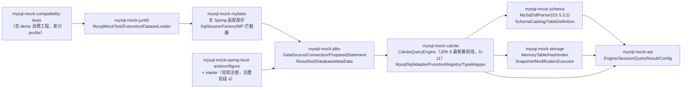
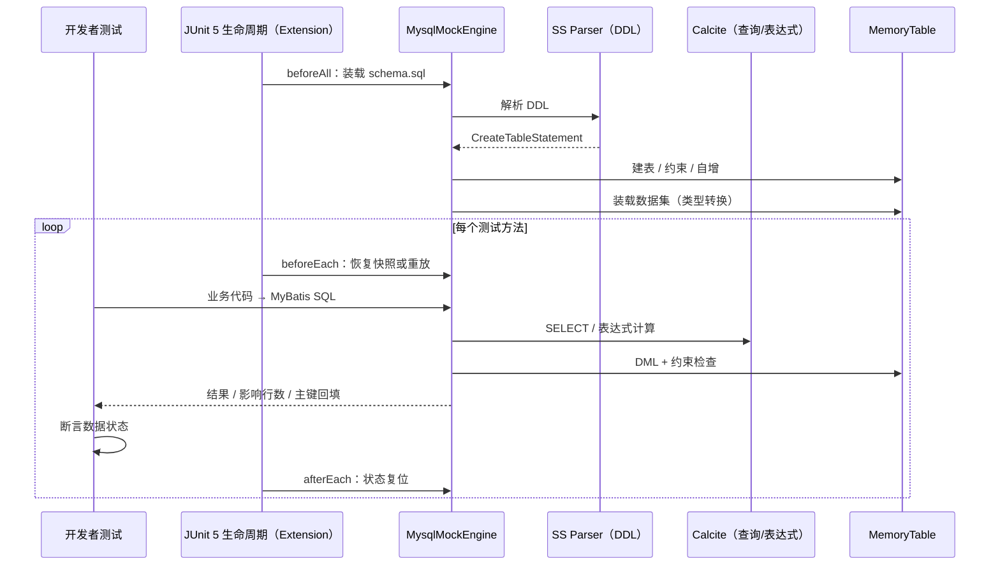

# mysql-mock-engine：实施方案

## 1. 范围与跨仓归属

目标仓为新建的独立 Maven 多模块仓，坐标 `cn.vv.test:mysql-mock-*`（OQ-3 已答复：内部坐标起步，开源发布另议），本期不修改任何现存仓；消费验证用独立 demo/兼容工程，不 deploy。跨仓协作：无（dine 服务迁移接入另期单独立项），业务步骤 owner 全部在新仓。

| 期次 | 内容 | 出口验收 |
|---|---|---|
| 阶段 0 PoC | JDK 8 上 Calcite（最新兼容线，D-11）+ SS 5.3.2 纵向闭环 | T0（Go/No-Go：Calcite jar 字节码断言 + shade 后消费方依赖树零新增） |
| 阶段 1 | Schema / Storage / DML / 查询 runtime + 原生 API | T1–T6、T11、T12 绿 |
| 阶段 2 | JDBC + 无 Spring 的 MyBatis 装配助手 | T7、T8、T13、T15 绿 |
| 阶段 3 | JUnit 5 扩展 + Mockito 共存 + 隔离 | T9、T10 绿 |
| 阶段 4 | Spring Boot starter + 差分兼容、函数扩展、发布 | T14、差分报告 + 兼容矩阵 + 示例工程 |

## 2. 代码事实

目标仓为新建，无存量代码。以下为消费基线与选型事实（除标注外均 2026-10-11 核实）。

| 事实 | 证据 | 状态 |
|---|---|---|
| 消费基线 JDK 8 / Boot 2.1.3.RELEASE | vv-locallife-framework 根 pom.xml:10,30（master 89010c3）；dine/AGENTS.md 服务表（点销、商品中心均 Java 8 / Boot 2.1.3） | 已核实 |
| MyBatis-Plus 3.4.3.4、junit-jupiter 5.10.2 显式钉版；Boot 2.1 starter-test 不带 jupiter | 同 pom:34,42-43,100-111 及注释 | 已核实（本仓 98 tests 实践验证） |
| Calcite JDK 8 支持：官方 history.md 载明 1.37.0 至 1.42.0（2026-05）均以 JDK 8 测试；第 1 轮评审记录「1.37.0 起要求 Java 11+」系检索摘要误读，第 2 轮评审已纠正 | calcite.apache.org docs/history（第 2 轮评审核实） | 已核实（jar 字节码未下载验证 → T0 首项） |
| Calcite 新版 guava 要求 ≥21.0；点销现网有效 guava 为 20.0，直接冲突（→ D-12 shade） | 第 2 轮评审依赖树核实 | 已核实 |
| `org.apache.shardingsphere:shardingsphere-sql-parser-mysql` 独立坐标止于 5.3.2（5.4+ 无该坐标） | Maven Central search | 已核实 |
| SS 5.3.2 根 pom `java.version=1.8`（编译基线），ANTLR runtime 4.10.1 | shardingsphere-5.3.2.pom | 已核实 |
| `@AutoConfiguration` 注解与 `.imports` 注册 = Boot 2.7+；Boot 2.1 只认 spring.factories 的 EnableAutoConfiguration 键；Boot 3.0 移除旧机制 | Spring Boot 官方文档 | 已核实 |
| `@DynamicPropertySource` = Spring 5.2.5；`DynamicPropertyRegistrar` = Spring 6.2；Boot 2.1.3 = Spring 5.1.3，两者均不可用 | Spring issues #24540 / #32271 | 已核实 |
| 原始方案 v1.0 与评审记录（P1-1、P2-1~3、P3-1~3） | 同目录 `输入-原始方案v1.0.md`、`输入-原始方案-评审记录.md` | 输入材料 |
| dine-order 单测形态：299 个测试类，@SpringBootTest 0、@RunWith 0、@ExtendWith(MockitoExtension) 6——纯 JUnit 5 + Mockito 单测，无 Spring 上下文 | grep 统计 vv-dine-order/src/test（2026-10-11） | 已核实 |
| dine-order 的 junit-jupiter 5.5.2（api 5.3.2）+ mockito-junit-jupiter 2.23.4 + mockito-core 2.23.4 由 `spring-cloud-starter-alibaba-nacos-discovery:2.1.2.RELEASE` 以 compile 域传递带入，pom 无显式声明 | `mvn dependency:tree -Dincludes=org.junit.jupiter,org.mockito` | 已核实 |
| spring-boot-starter-test 2.1.3 自身只带 JUnit 4.12 + mockito-core，无 jupiter | spring-boot-starter-test-2.1.3.RELEASE.pom（本地仓库） | 已核实 |
| product-center 单测同形态（82 个测试类，无 Spring 上下文注解）；jupiter 5.10.2 经 framework-parent 钉版 | grep 统计 vv-product-center/src/test；framework 根 pom:42-43 | 已核实 |
| dine-order 已在 test 域使用 jedis-mock（中间件内存替身同模式先例） | vv-dine-order/pom.xml 依赖清单 | 已核实 |
| 现网 DDL 含 STORED 生成列并配 UNIQUE 承载业务不变量：dine_customer.occupies_unique、dine_customer_phone.occupies_unique / default_guard、sku_unit.default_marker | 第 2 轮评审现网 DDL 核实（→ D-13） | 已核实 |
| 两服务 272 个 SQL 文件 FOREIGN KEY 0 命中 | 第 2 轮评审 grep（→ D-13 外键显式拒绝） | 已核实 |
| Calcite 表修改通道只实现 INSERT/DELETE；UPDATE 直接抛 AssertionError；DELETE 绕过约束检查 | EnumerableTableModify 实现（第 2 轮评审核实，→ D-03 修订） | 已核实 |
| SS parser 传递链带 groovy 4.0.6、snakeyaml 1.33、caffeine、truffle-api；Boot 2.1.3 会把 snakeyaml/caffeine 调停到低版本 | 第 2 轮评审依赖树（→ D-12 shade） | 已核实（truffle-api / caffeine 具体解析版本待 T0） |
| dine-order 残留手写 H2 schema（db/h2/{schema,data}.sql），即 D-15 所指历史包袱 | 仓内文件（dine/AGENTS.md local profile 现状注记） | 已核实 |

风险提示：dine-order 的 jupiter 由 nacos starter 泄漏提供而非显式声明，升级 nacos 可能改变其单测栈——这是消费方自身工程事项，本仓兼容矩阵按 junit-jupiter-api 5.3.2（BOM 调停后点销实际 api 版本）与 5.10.2 两档覆盖，不依赖该泄漏的存在。

未核实项（T0 / 阶段 0 实测）：Calcite 1.42.0 jar 实际字节码级别（官方声明以 JDK 8 测试，未下载验证，T0 第一项断言）；SS 传递链 truffle-api / caffeine 的具体解析版本。classpath 冲突面已由第 2 轮评审判定（guava 20.0 vs ≥21.0、snakeyaml/caffeine 调停），处理统一走 D-12 shade。

## 3. 做法与落点

### 3.1 模块结构 [D-03][D-07][D-11][D-12]



依赖单向：jdbc → calcite → {schema, storage} → api（calcite 依赖 schema 与 storage 的自有模型，与图一致）；mybatis 助手、JUnit、Spring、兼容测试逐层在外，JUnit 接入不依赖 Spring。Calcite、SS、ANTLR 的类型不泄漏进 api 包；发布物统一 shade + relocate 内部依赖（D-12），消费方依赖树零新增。

### 3.2 JDK 8 工具链门禁 [D-01][R8]

全模块 `maven.compiler.source/target=1.8`；CI 以 JDK 8 为唯一构建与测试线（本机 Zulu 1.8.0_502 已在 vv-locallife-framework 验证可行）；JDK 11/17 不做矩阵投入（OQ-4：先不承诺），字节码 52 天然可运行的事实不做验收。animal-sniffer（signature `java18`）拦截 JDK 9+ API；compat 模块加字节码版本断言（class major version = 52）。依赖隔离走 shade + relocate（D-12）：Calcite、SS Parser 及 guava / jackson / ANTLR / groovy / snakeyaml / caffeine / truffle-api 等传递依赖全部 relocate 后打入自有 artifact，消费方依赖树零新增；不做 enforcer 白名单调停。

### 3.3 Schema 域 [R1][D-03]

`MySqlDdlParser` 封装 SS 5.3.2 的 MySQL 解析器，取 CREATE TABLE 语句对象转为自有 `TableDefinition / ColumnDefinition / IndexDefinition`（Java 8 不可变类，替代原方案的 record）。DDL 属性三分法：

| 类别 | 处理 | 例 |
|---|---|---|
| 影响执行行为 | 实现或显式拒绝 | UNSIGNED、UNIQUE、NOT NULL、DEFAULT、AUTO_INCREMENT、STORED 生成列（表达式求值并参与唯一约束，D-13）、清单内 collation（`utf8mb4_general_ci` / `utf8mb4_unicode_ci`，列级覆盖表级，等值/UNIQUE/GROUP BY 按大小写不敏感 + PAD SPACE，D-16）实现；CHECK 约束、VIRTUAL 生成列、外键、清单外 collation 显式拒绝（现网 0 外键） |
| 不影响测试结果 | 接受并保留 | ENGINE、表/列 COMMENT |

生成列两种语法（`GENERATED ALWAYS AS (...) STORED` 与简写 `AS (...) STORED`，现网均有使用）都要解析；生成列表达式求值限于 R3 白名单函数，超白名单装载时显式失败（D-13）。

`SchemaCatalog` 支持 `database.table` 名字解析与可配置大小写行为。

### 3.4 Storage 域 [R4][D-07]

`MemoryTable` 持行 ID、行值（防御性拷贝出入）、主键/唯一 HashIndex、自增指针。写路径统一经 `ModificationExecutor`：约束检查（主键/唯一/NOT NULL/默认值）→ STORED 生成列求值（复用 Calcite 表达式求值，D-13）→ 行变更 → 索引更新，在同一同步块内原子完成。`SnapshotManager` 做整库深拷贝（含自增指针等全局状态），恢复即整表替换；测试数据量级（几十到几千行）下不做 Copy-on-Write 优化，留作后续。

### 3.5 Query / DML 域 [R3][D-03]

`CalciteQueryEngine` 内嵌 Calcite（JDK 8 最新兼容线，D-11）的 parser + validator + planner + enumerable 执行，conformance 以 `MYSQL_5` 起步；方言差异（反引号、`LIMIT offset, count` 等）在 `MysqlSqlAdapter` 预处理或 parser 配置解决，并维护已知差异登记表。Calcite 只承担 SELECT 查询执行与表达式求值；INSERT/UPDATE/DELETE 由 `ModificationExecutor` 执行——WHERE 匹配经 Calcite 表达式求值、行变更与约束维护在自有代码（Calcite 表修改通道 UPDATE 抛错、DELETE 绕过约束，不采用，D-03）。UPDATE 的实现路径：改写为「SELECT 行 ID + SET 表达式」经 Calcite 求值得到目标行与新值，再由执行器写回并维护索引。`MysqlFunctionRegistry` 将首批函数注册进 Calcite OperatorTable（类型推导与求值绑定 Calcite 表达式系统）；未注册函数按 R9 显式失败。`MysqlTypeMapper` 是 MySQL 类型 ↔ Calcite 类型的唯一转换点 [D-07]；DECIMAL → BigDecimal、时间保精度与时区 [D-08]。

### 3.6 JDBC 层 [R5][D-05]

自有 `MysqlMockDataSource / Connection / PreparedStatement / Statement / ResultSet / ResultSetMetaData / DatabaseMetaData`，内部走引擎 Session。阶段 2 验收必须覆盖：close/isValid、`?` 绑定（setObject/setNull）、Batch、executeQuery/executeUpdate、getObject/getLong/getBigDecimal/getTimestamp/wasNull、列名/别名/类型/精度/可空、getTables/getColumns/getPrimaryKeys、getURL（返回 `jdbc:mysql:mock:` 前缀）与 getDatabaseProductName（返回 MySQL，MyBatis-Plus 分页插件据此自动识别方言）、Generated Keys 回填。事务语义按 D-14：自动提交，`commit()` 合法空操作，`rollback()` / `setAutoCommit(false)` 显式抛 SQLFeatureNotSupportedException。异常按 §4 错误表抛 `SQLException`；影响行数默认 matched [D-10]。

### 3.7 单测接入：JUnit 5 扩展 + 无 Spring 的 MyBatis 装配 [R6][D-05]

- `mysql-mock-junit5` 按 junit-jupiter-api 5.3.2 基线编译（点销经 Boot 2.1.3 BOM 调停后的实际 api 版本；5.5.2 / 5.10.2 运行兼容），只用 5.0 起稳定的扩展 API；扩展负责 schema/dataset 装载与每方法隔离（3.9）。
- `mysql-mock-mybatis` 装配助手（不依赖 Spring）：以引擎 DataSource 构建 `SqlSessionFactory`，注册 Mapper、按需挂 MyBatis-Plus 分页等拦截器，`getMapper(Class)` 直接供单测使用；事务工厂为内置自动提交实现（D-14），MyBatis 会话的 commit/rollback 不触发 JDBC 层拒绝；与 `MockitoExtension` 同测类共存——非 DB 协作件照常 mock。
- Mockito 不进入本仓依赖树，仅在兼容测试以 2.23.4（消费方最低线）做共存验证（T9、T13）。

### 3.8 Spring 层（后置，阶段 4）[R6][D-04]

注册双轨：`META-INF/spring.factories`（EnableAutoConfiguration 键，Boot 2.1–2.6）与 `META-INF/spring/org.springframework.boot.autoconfigure.AutoConfiguration.imports`（2.7+/3.x；随包发布但不做运行验证，OQ-4 先不承诺）；配置类用 `@Configuration + @AutoConfigureBefore(DataSourceAutoConfiguration.class)`，不用 `@AutoConfiguration` 注解（Boot 2.7+ 才存在）。装配前提 `mysql-mock.enabled=true`。

- 模式 B（创建）：测试应用没有 DataSource 时，注册唯一的 mock DataSource。
- 模式 A（接管）：`mysql-mock.replace-datasource-bean=<beanName>` 显式指定时，经 `BeanDefinitionRegistryPostProcessor` 替换该 Bean 定义；两种模式都要求显式开启，引擎的 DataSource 拒绝连接任何非内存目标。
- Spring 5.1 无动态属性机制：动态注入走 `ApplicationContextInitializer` 或直接以 Bean 暴露 DataSource。
- 生命周期与 TestContext 缓存解耦 [D-06]：状态复位以 junit5 Extension 触发为一等入口（3.7）；starter 接入时另挂 Spring `TestExecutionListener`，避免与缓存的上下文同生命周期。

### 3.9 隔离 [R7][D-06]

RECREATE：重放 DDL 与数据集；SNAPSHOT：初始化后快照，测试方法结束恢复并重置自增、索引、会话状态。策略经 `mysql-mock.reset.strategy` 配置；不提供 TRANSACTION 模式。

### 3.10 差分兼容 [D-09][R3][R4]

`-Pcompat` profile 在 CI 起真实 MySQL 8.0（容器）：同一 DDL + 数据 + SQL 双跑，`ResultNormalizer` 只归一协议表示（无 ORDER BY 不比顺序），差异报告覆盖行/NULL/类型/排序/影响行数/错误码，落 `compatibility-report/`。语料库取点销 + 商品中心现网 DDL 与 Mapper SQL（OQ-5 已答复）；基准实例参数（sql_mode / collation / time_zone）随语料采集，引擎按采集值初始化会话（D-09）。指标（DDL 解析通过率 ≥95%、声明范围内一致率 100%）为阶段 4 规划目标，不是现状承诺。



## 4. 契约

库契约 = 公共 API + 配置键 + 异常语义 + 注解，均为拟新增（Java 8 风格，不用 record / 文本块）。

公共 API 核心（`mysql-mock-api`，拟议）：

```java
public interface MysqlMockEngine extends AutoCloseable {
    void executeDdl(String ddl);
    QueryResult query(String sql, Object... params);
    UpdateResult execute(String sql, Object... params);
    void loadDataset(Dataset dataset);
    DatabaseSnapshot snapshot();
    void restore(DatabaseSnapshot snapshot);
    DataSource dataSource();
}
```

builder 用法（拟议）：`MysqlMockEngine.builder().mysqlVersion("8.0").schema("classpath:mysql/schema.sql").build()`；数据集 `engine.dataset().table("t_user").row("id", 1L, "name", "Alex", "status", 1).load()`。

无 Spring 装配助手（拟议，阶段 2 交付）：`MysqlMockMybatis.builder().engine(engine).mapperPackage("com.vv.dine.mapper").build()`，`getMapper(OrderMapper.class)` 直接供单测使用；MyBatis-Plus 分页等拦截器按需注册。

配置键（starter，前缀 `mysql-mock`，阶段 4 交付）：

| 键 | 语义 |
|---|---|
| `enabled` | 必须 true 才装配（默认不装配） |
| `schema.locations[]` | DDL 资源位置 |
| `dataset.locations[]` | YAML 数据集位置 |
| `reset.strategy` | `RECREATE`（默认）/ `SNAPSHOT` |
| `sql.strict` | 默认 true，白名单外 SQL 显式失败 |
| `replace-datasource-bean` | 模式 A 的接管目标 Bean 名 |
| `compatibility.*` | mysql-version / sql-mode 声明期望；未实现项启动时显式反馈 |

注解（一等接入，阶段 3 交付）：`@MysqlMockTest(schema, datasets, resetStrategy, mapperScan)`；`mapperScan` 声明装配助手的 Mapper 扫描包。

错误语义（`SQLException`，vendorCode/SQLState）：主键或唯一冲突 1062/23000；NULL 违反 1048/23000；表不存在 1146/42S02；语法或未支持 1064/42000（strict 不静默）。影响行数默认 matched，可配 changed [D-10]。事务：自动提交；`rollback()` / `setAutoCommit(false)` 抛 SQLFeatureNotSupportedException（D-14）。

兼容矩阵（OQ-4 已答复：先不承诺 Boot 3.x / JDK 17，唯一承诺列为加粗项）：

| JDK \ Boot | 2.1.3 | 2.7 | 3.x |
|---|---|---|---|
| **8** | **承诺（唯一承诺列）** | 未验证（.imports 随包发布） | 不适用 |
| 11 | 未验证 | 未验证 | 不承诺 |
| 17 | 未验证 | 未验证 | 不承诺 |

单测接入（不依赖 Boot 版本，阶段 2–3 即可用）按两档做兼容验证：junit-jupiter-api 5.3.2（点销实际加载的 api 版本）/ 5.10.2（framework 钉版）、mockito 2.23.4（消费方最低线）。

## 5. 怎么验

落点为新仓拟议测试类；java-tdd 门禁标注：A = SQL 语义/约束行为（同一测试红绿两段），B = 装配/编排（场景运行），D = 纯封装守卫。新仓沿用工作区 Java 仓 TDD 纪律。

| 场景 | 关联 | 前提与操作 | 期望 | 落点（拟议） | 门禁 |
|---|---|---|---|---|---|
| T0 阶段0闭环 | D-01 D-03 D-11 D-12 | JDK 8（Zulu 1.8）上先断言 Calcite 1.42.0 jar 字节码 = 52；再以 Calcite + SS 5.3.2 完整依赖树装现网 dine_customer / dine_customer_phone DDL（含 STORED 生成列）+ 数据集，跑 JOIN/GROUP BY/HAVING 查询与 INSERT→UPDATE→DELETE 全链 | 全链通过（UPDATE 走自有执行器）；生成列求值与唯一约束正确；shade 打包后消费方依赖树零新增（T13 最小断言前移）；产出 SS 传递依赖（truffle-api / caffeine 等）解析清单 | PoC `Stage0PocTest` | PoC（Go/No-Go） |
| T1 DDL 装载 | R1 D-13 | 装载含 UNSIGNED、DECIMAL(18,2)、DATETIME(3)、AUTO_INCREMENT、主键、唯一、普通索引、STORED 生成列、COMMENT、ENGINE 的真实 DDL（现网 dine_customer 语料） | catalog 中列/类型/精度/可空/默认/主键/唯一/自增与 DDL 一致；生成列登记表达式与唯一约束 | `SchemaCatalogTest` | A |
| T2 DDL 拒绝 | R1 D-13 | 分别装载含 FOREIGN KEY、CHECK 约束、VIRTUAL 生成列的 DDL | 三者均装载失败并指向 DDL 位置（外键不再降级告警） | `MySqlDdlParserTest` | A |
| T3 数据集装载 | R2 | YAML 含金额 100.00、时间 2026-01-02 03:04:05.678 | 金额以 scale=2 的 BigDecimal 入库；时间保留毫秒精度 | `DatasetLoaderTest` | A |
| T4 白名单 SELECT | R3 | 原方案示例 SQL（LEFT JOIN + SUM + GROUP BY + HAVING + ORDER BY + LIMIT）带参数 | 结果行与手工期望一致；compat profile 下与真实 MySQL 一致 | `SelectExecutionTest` + compat | A |
| T5 INSERT 语义 | R4 D-16 | 插入含默认值列、缺省自增列；再插重复主键；再插清单内 collation 列的大小写变体唯一键 | 默认值填充；自增回填 generatedKeys；重复主键抛 1062/23000；大小写变体唯一键同样抛 1062（_ci 语义） | `InsertExecutionTest` | A |
| T6 UPDATE/DELETE | R4 D-10 | UPDATE 一行改值、一行不改值；随后 DELETE 部分行 | 默认 matched 语义影响行数=2，配置切 changed 后=1；索引一致（唯一列改值后旧值可复用） | `UpdateDeleteExecutionTest` | A |
| T7 MyBatis 端到端 | R5 | 真实 XML 动态 SQL + resultMap 的 Mapper，useGeneratedKeys | CRUD 正确、主键回填到实体字段 | `MybatisEndToEndTest` | B |
| T8 MyBatis-Plus | R5 | MP 3.4.3.4：BaseMapper + 分页插件 + 逻辑删除 + 自动填充 | CRUD 与分页 total/records 正确；逻辑删除为 UPDATE；填充字段生效 | `MybatisPlusEndToEndTest` | B |
| T9 单测接入共存 | R6 D-05 | jupiter 5.5.2 + MockitoExtension 测试类：@Mock 外部协作件、装配助手提供真 Mapper，执行 Service 方法 | 外部协作件返回 stub 值；Mapper SQL 真执行且数据状态正确 | `JunitMockitoCoexistenceTest` | B |
| T10 隔离 | R7 | 同一 jupiter 扩展生命周期（引擎实例复用）两个测试方法，A 插入后 B 计数 | RECREATE 与 SNAPSHOT 下 B 的计数均为初始值；自增指针复位；Spring 上下文缓存场景随 T14 覆盖 | `IsolationTest` | A |
| T11 未支持显式失败 | R9 | 执行白名单外 SQL（如窗口函数） | 抛含 SQL 片段与定位的错误，不返回空结果 | `StrictModeTest` | A |
| T12 JDK 8 门禁 | R8 D-01 | 构建产物扫描 + animal-sniffer | 全部 class major=52；签名检查零违规 | `BytecodeVersionTest` + CI | D |
| T13 classpath 零新增 | R8 D-12 | demo 工程 = Boot 2.1 BOM 依赖树 + 本库（shade 后） | 消费方 `dependency:tree` 无新增传递依赖；公共 API 无 relocated 包名类型泄漏；CRUD 正常（无 NoClassDefFoundError） | demo `ClasspathCoexistenceIT` | B |
| T14 Boot 2.1 starter 装配 | R6 D-04 | 阶段 4：demo 工程 Boot 2.1.3 + JDK 8，无任何真实库配置 | DataSource 为 mock 实现；spring.factories 路径验证可装配；.imports 文件存在性检查（不做运行验证） | demo `Boot21AutoConfigIT` | B |
| T15 事务边界 | D-14 | JDBC 直连：INSERT 后调用 rollback()；另调用 setAutoCommit(false) | 两者均抛 SQLFeatureNotSupportedException 且错误信息说明支持级别；数据保持已写入状态（自动提交语义） | `TransactionSemanticsTest` | A |

差分证据：T4、T6 在 `-Pcompat` 下与真实 MySQL 8.0 对照，报告落 `compatibility-report/`。执行证据追加同目录 `验证记录.md`（日期、命令、T 编号、PASS/FAIL/BLOCKED、输出指针）。

阶段门禁汇总：阶段 0 出口 = T0；阶段 1 出口 = T1–T6、T11、T12 绿；阶段 2 出口 = T7、T8、T13、T15 绿；阶段 3 出口 = T9、T10 绿；阶段 4 出口 = T14 绿 + 差分报告 + 兼容矩阵 + 可复现示例工程。
